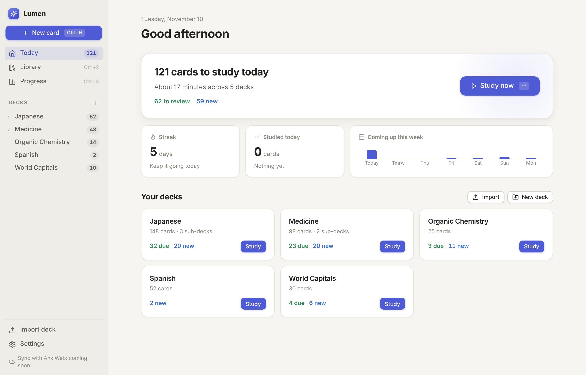

# Lumen

A calm, modern flashcard app for macOS, built on **Anki's engine**.

Lumen is a brand-new interface. Underneath, it uses Anki's official, open-source engine (the `anki` Python package), so scheduling, card rendering, search and your review history work the same as in Anki. Lumen opens regular Anki collections and imports `.apkg` decks.



## Download (easiest)

Get the app from the **[Releases page](../../releases/latest)**:

- **Lumen-macOS-apple-silicon.zip** is for Macs with an M1 chip or newer.
- **Lumen-macOS-intel.zip** is for Intel Macs.

Unzip it and drag **Lumen** into Applications. The first time you open it, macOS will say it can't verify the app, because it isn't signed by Apple. Go to **System Settings → Privacy & Security**, click **Open Anyway**, and confirm. The release page has the full steps.

## Run from source (macOS)

1. **Install Python 3.10 or newer** from [python.org](https://www.python.org/downloads/macos/) if you don't have it. macOS's built-in Python is too old.
2. **Double-click `Start Lumen.command`.**
   - The first launch sets things up, which takes about a minute.
   - If macOS says it can't verify the file, right-click it and choose **Open**.
3. Lumen opens in its own window. Later launches take a second or two.

On first run you can:

- **Bring over your Anki cards.** Lumen finds your Anki profile and *copies* it, including media and progress. Quit Anki first. Your Anki stays exactly as it was.
- **Try a sample deck.**
- **Import a deck file** (`.apkg`).
- **Start from scratch.**

### Build the Mac app yourself (optional)

On your Mac, run `./build_mac_app.sh` in Terminal. It creates `dist/Lumen.app`, which you can drag to Applications.

Releases are built automatically by GitHub Actions (`.github/workflows/release.yml`). To publish a new version, raise `__version__` in `lumen/__init__.py` and push to `main`, or push a tag like `v0.2.0`.

### Windows and Linux

Lumen is cross-platform:

- **Windows:** double-click `start.bat` (needs Python from python.org).
- **Linux:** run `./start.sh`.

Add `--browser` to use your web browser instead of a native window.

## What's different from Anki

| In Anki | In Lumen |
|---|---|
| Deck list with New/Learn/Due columns | A **Today** screen: "121 cards to study, about 16 minutes", one **Study now** button for everything, plus your streak and the week ahead |
| Choose a deck → Overview → Study Now | Press **Enter** on Today, or **Study** on any deck card |
| Again / Hard / Good / Easy | Same four choices, colour-coded, with the next interval and keys **1–4** shown on each. Space shows the answer, then picks Good |
| Edit window during review | Press **E** to edit the card in a side panel without leaving study mode |
| Add window with "Type" and "Deck" pickers | **New card** (⌘N) from anywhere. Card types have plain names ("Question & answer", "Fill in the blank") with a one-line explanation. You're warned about duplicates as you type, and **Undo** appears after every add |
| Browse window | **Library**: one search box, filter chips (Due today, New, Flagged, Difficult, Paused…), and edit / preview / details next to the list. Select several cards to pause, move, flag or delete them |
| Deck options with dozens of fields | **Daily pace** presets (Light / Steady / Intensive / Exam prep) and a sentence explaining what they mean. Everything else is under "Advanced", with a plain description for each setting. Lumen tells you when settings are shared with other decks and lets you split them off |
| Suspend / Bury / Leech | Pause / Hide until tomorrow / Difficult |
| Statistics | **Progress**: reviews, time, days studied, recall rate, reviews per day, what's coming up, and how well you know your cards |
| Undo in the Edit menu | **Z** or ⌘Z everywhere, plus an Undo button in each confirmation message |

It also follows your Mac's light/dark setting, and renders cards in a sealed-off frame, so a card's own code can't affect the app.

## Keyboard

| Keys | Action |
|---|---|
| ⌘N | New card |
| ⌘1 / ⌘2 / ⌘3 | Today / Library / Progress |
| ⌘F | Search the library |
| Space or Enter | Show answer, then "Good" |
| 1 2 3 4 | Again · Hard · Good · Easy |
| E | Edit the current card |
| Z or ⌘Z | Undo |
| Esc | Leave study mode / close |
| ⌘↵ | Add the card (in New card) |
| ⌘⇧C | Hide the selected words (fill in the blank) |

## Where your cards live

Lumen keeps its own collection in `~/Library/Application Support/Lumen/collection/`. It's a normal Anki collection, so Anki can open it too (just not while Lumen is running).

Under **Settings → Your cards**, you can also open your Anki profile *directly*, so both apps share the same cards. If you do, never run both at the same time, and make a backup in Anki first.

## Not yet included

- **AnkiWeb sync.** The engine supports it, but the sign-in and conflict screens are still to come. The code for it lives in `lumen/engine.py`.
- Image Occlusion cards: they need Anki's own desktop code to display, so they won't show correctly in Lumen yet. Lumen also hides that card type when you add cards.
- Editing card templates and styling, filtered decks and custom study, exporting, and CSV import. Anki can still do these on the same collection.
- Pasting images into fields. Pasted text comes in as plain text.
- Maths formulas: MathJax (`\( … \)`) isn't rendered yet, so formulas show as plain text.
- Translations: the interface is English only.

## How it's built

```
Start Lumen.command   macOS launcher (sets up .venv on first run)
build_mac_app.sh      builds dist/Lumen.app with PyInstaller
lumen/
  engine.py           the only file that talks to Anki's engine
  server.py           local HTTP server: 127.0.0.1 only, per-launch secret token
  paths.py            where files live on each OS
  main.py             starts the server and opens the native window (pywebview)
  web/                the interface: Preact + htm, no build step, works offline
    js/               one file per screen (home, study, add, library, deck, stats, settings)
    css/app.css       design system (tokens, light and dark)
```

The interface talks to the engine through a small JSON API. To add sync later, add the `sync_login` / `sync_collection` calls in `engine.py` and a settings screen. Nothing else needs to change.

## License

Lumen uses Anki's engine, which is licensed under the GNU AGPL v3, so Lumen is AGPL-3.0 too (see `LICENSE`). It's free to use, and if you distribute it or a modified version, you must share the source code under the same license.

Bundled libraries:

- Preact (MIT)
- htm (Apache-2.0)
- Lucide icons (ISC)

See `lumen/web/vendor/LICENSES.txt`.

"Lumen" is a working name. Lumen isn't affiliated with or endorsed by Anki or Ankitects.
